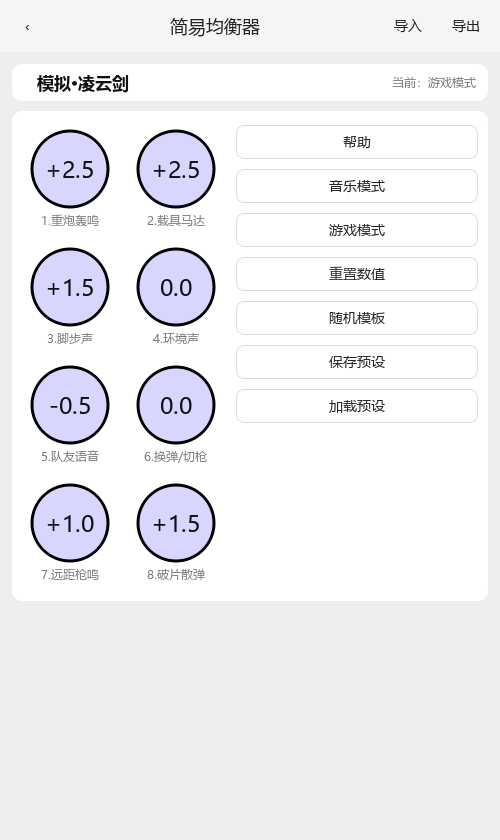
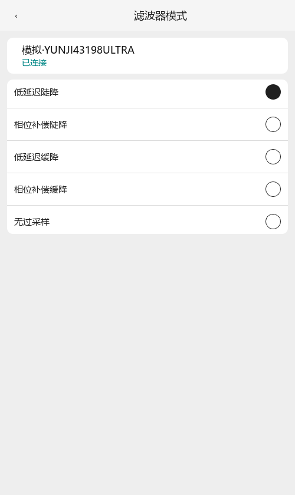
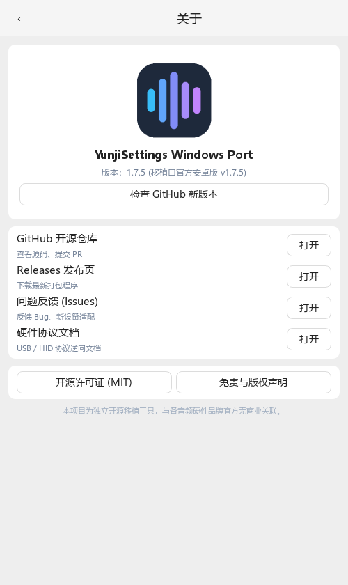

# 云姬电脑版 · yunji-win

> **云姬 Windows 版（非官方开源移植）** —— 让云姬小尾巴 / Type-C 解码耳放在电脑上也能自由调音：8 段参数均衡器、DAC 硬件音量、麦克风增益、声道平衡、数字滤波器切换。

**关键词**：云姬电脑版 · 云姬 Windows 版 · 云姬 PC 版 · 云姬电脑端下载 · 小尾巴调音软件 · 解码耳放 EQ 工具 · TTGK · 旋润 · USB DAC 调音

🌐 **官网落地页**：<https://binbin-miao.github.io/yunji-win/> ｜ ⬇ **下载**：[Releases](https://github.com/Binbin-miao/yunji-win/releases/latest)

[](LICENSE)
[]()
[]()

---

## 📖 项目简介

本项目为独立开发的第三方 Windows 桌面端移植版本（移植参考自官方 Android 端 v1.7.5 架构与通信协议），即社区常说的「**云姬电脑版**」。

由于市面上多数便携式解码耳放（小尾巴）仅提供了移动端 App，Windows 用户在连接电脑使用时往往无法便捷地调节 DAC 滤波模式、耳放增益档位、麦克风输入电平，更无法调用设备内置的硬件 DSP 进行专业 Parametric EQ / Easy EQ 调音。

**本项目实现了：**
- **免驱直通 (TTGK 阵营)**：利用 Windows 内置 HID 驱动，无需安装 WinUSB 或任何第三方驱动，即插即用。
- **全参数硬件 EQ 调节 (ProEQ)**：8 段双二阶 Peaking EQ 实时曲线拟合计算，一键写入硬件 DSP。
- **简易均衡器 (EZEQ)**：针对音乐与游戏场景定制特征频点与调音模板。
- **DAC 与硬件参数精细调节**：硬件音量、声道平衡、麦克风电平、高低增益、滤波器类型、LED 开关。
- **设备热插拔自动侦测**：即插即认，状态自动同步。
- **开源合规与中性设计**：本仓库完全剔除原厂商业资源与专有位图，提供自研中性数据并支持用户外部资源覆盖。

---

## 🖼️ 界面预览

| 设备列表 | TTGK 设备主页 | 参数均衡器 (ProEQ) |
| :---: | :---: | :---: |
|  |  |  |

| 简易均衡器 (EZEQ) | 滤波器切换 | 关于与声明 |
| :---: | :---: | :---: |
|  |  |  |

---

## 🎧 支持硬件

| 品牌 / 协议阵营 | 代表型号 | 通信方式 | 驱动要求 | 核心特性 |
| :--- | :--- | :--- | :--- | :--- |
| **TTGK 系列** | 凌云剑、Q25 等 (CB1200 / CB5100 架构) | USB HID 中断传输 | **Windows 原生免驱** | 8 段硬件 EQ、增益、滤波、LED、声道平衡、麦克风 |
| **旋润 系列** | YUNJI43198PRO、YUNJI43198ULTRA、You Got Me 等 | USB 控制传输 | WinUSB / libusb | 硬件音量、平衡、增益、5 档滤波、LED、防爆音 |

---

## 🚀 快速上手

### 方式一：下载开箱即用的 Release 版本（推荐）

前往 [GitHub Releases](https://github.com/Binbin-miao/yunji-win/releases) 页面，下载最新的 `YunjiSettings-v1.7.5-win64.zip`，解压后双击运行 `YunjiSettings.exe` 即可使用。

### 方式二：从源码运行

要求 Python 3.10 及以上环境：

```bash
# 1. 克隆本仓库
git clone https://github.com/Binbin-miao/yunji-win.git
cd yunji-win

# 2. 安装依赖
pip install -r requirements.txt

# 3. 运行桌面端应用
python app/main.py
```

---

## 🛠️ 打包独立 EXE

本项目支持使用 `PyInstaller` 打包为免安装的单目录/单文件程序：

```bash
pip install pyinstaller
pyinstaller --noconfirm --windowed \
    --name YunjiSettings \
    --icon app/assets/icons/app.ico \
    --add-data "app/assets;assets" \
    --collect-binaries hidapi \
    --collect-all libusb_package \
    --paths app \
    --distpath dist \
    app/main.py
```

---

## 🎨 资源覆盖机制 (Assets Override)

本开源项目已将所有图标、预设与配置完全中性化。如果高级用户拥有合法提取的原厂或自定义资源包，只需将对应文件夹放置于用户数据目录下：

```text
%APPDATA%\YunjiSettings\assets-override\
  ├── icons\
  ├── ezeq-config\
  ├── ezeq-template\
  └── product-list\
```

软件在启动与读取资源时，将自动优先加载 `assets-override\` 下的内容；若不存在则回退至开源中性资源。

---

## 📚 技术文档

- [硬件通信与 DSP 协议规范](docs/协议参考.md)：包含 TTGK 64 字节 HID 报文定义、旋润 7 字节控制传输协议、8 段 Biquad EQ 定点系数计算公式。

---

## ❓ 常见问题 (FAQ)

**Q：云姬电脑版是官方软件吗？**
不是。本项目是独立开发者出于学习与跨平台便利性所做的**非官方开源移植**，与任何音频硬件品牌官方均无商业合作、赞助或授权关系，相关商标归原权利人所有。

**Q：云姬电脑版要装驱动吗？**
TTGK 阵营设备使用 Windows 原生 HID 驱动，**无需额外安装任何驱动**，插上即用；旋润阵营设备基于 USB 控制传输，若未识别可参考本文档上方的驱动说明。

**Q：云姬电脑版支持哪些设备？**
目前支持 TTGK 阵营（凌云剑、Q25 等，CB1200 / CB5100 架构）与旋润阵营（YUNJI43198PRO、YUNJI43198ULTRA、You Got Me 等）。若你的设备未在列表内，欢迎在 [Issues](https://github.com/Binbin-miao/yunji-win/issues) 提交设备信息协助适配。

**Q：会不会刷坏我的设备固件？**
不会。软件只会按你的操作读写设备的可配置参数（音量、EQ、滤波档位等），不会刷写固件；所有写入操作都需要你主动点击保存。

**Q：云姬电脑版和手机 App 的调音效果一致吗？**
一致。本项目复刻了设备端的 8 段双二阶滤波器计算方式（固定 96 kHz 基准采样率、Q30 定点量化），并已在真机上完成读写与提交验证，参数与手机端表现相同。

**Q：可以在 Linux / macOS 上用吗？**
协议层与 UI 均为 Python 实现，理论上可移植，但目前仅在 Windows 10 / 11 上完成测试与打包。欢迎社区提交跨平台适配 PR。

---

## ⚠️ 免责声明 (Disclaimer)

1. 本项目为个人爱好者的开源移植与研究成果，**与「云姬」、「旋润」、「TTGK」或任何关联音频硬件制造商官方无商业合作或授权关系**。
2. 文档与界面中出现的品牌名称与设备型号仅用于客观标示硬件兼容范围，其商标与知识产权归原合法权利人所有。
3. 软件按 MIT 许可证「按现状 (AS-IS)」提供。开发者对使用本工具调节设备可能带来的任何硬件异常不承担担保责任。

---

## 📄 开源许可证

本项目基于 [MIT License](LICENSE) 开源。
